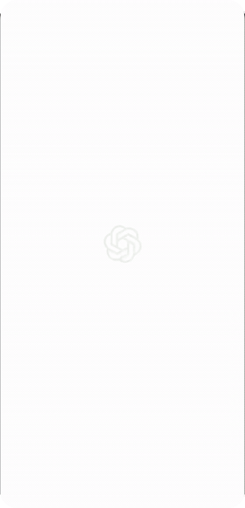

### Let the ChatGPT app control your phone

  

## Installation

### 1. Download the APK

Go to [Releases](https://github.com/horacioMartinez/chatgpt-unleashed/releases/latest) and download the latest `unleashed.apk`.

### 2. Install on your device

Since the app is not distributed through an app store, you'll need to allow installation from this source. On most Android devices:

1. Open the downloaded APK file.
2. If Android asks you to allow installation from this source, tap **Allow**.
3. Tap **Install**.

> **Note:** If Android blocks installation with a message such as “App blocked to protect your device,” temporarily disable Play Protect app scanning:
>
> Play Store → Profile picture → Play Protect → Settings → Scan apps with Play Protect

Once the app is installed:

- Enable **Accessibility** inside the app.
- Connect to the ChatGPT plugin using your Tunnel ID and Secret key (see the next section).

### 3. ChatGPT plugin installation

Use the same OpenAI account you will use in the ChatGPT mobile app.

Log in to [OpenAI Platform](https://platform.openai.com/), then follow these steps:

1. Open [Tunnel settings](https://platform.openai.com/settings/organization/tunnels), click **Create tunnel**, and complete the fields:

   - Name: `my_unleashed_private_tunnel`
   - Description: `-`
   - Organizations: Select your organization or leave the default.
   - ChatGPT workspaces: Select your workspace or leave the default.

   Create the tunnel and copy its Tunnel ID. You'll use it later.

2. Open [API keys](https://platform.openai.com/api-keys), click **+ Create new secret key**, and complete the fields:

   - Name: `my_unleashed_private_tunnel_key`
   - Project: Select your project or leave the default.
   - Expiration: **Never**
   - Permissions: Select **Restricted**, then enable **Read** and **Use** under Tunnels.

   Create the key and copy the Secret key. You can only view it when it is created.

3. Open unleashed and tap **Connect ChatGPT**. Enter the Tunnel ID and Secret key, then connect. Check that the connection succeeds.

4. Open [https://chatgpt.com/plugins](https://chatgpt.com/plugins) in your browser.

   Choose **Add → Add custom MCP server**:

   - Name: `unleashed`
   - Connection: Select **Tunnel** and paste your Tunnel ID.
   - Authentication: Choose **No authentication**.

   Then choose **Connect unleashed**.

5. Verify that unleashed works by asking ChatGPT:

   > Using @unleashed, open my calculator app and compute 1 + 1.

## Phone controls

A screen read returns the visible elements and their pixel bounds. Foreground app elements can also carry a `ref`, a list of supported `actions`, and their keyboard focus state (`inputFocused`). Use the reference directly when choosing an element. If the element moves, its reference can still resolve. If it disappears or changes identity, read again after `STALE_ELEMENT`.

To enter text step by step, read the screen and choose the editor’s `ref`. Call `focus` and verify `inputFocused: true` on that editor in the returned screen. Call `type` and verify the field value in its returned screen. Both actions include an observation, so a separate read is only needed if it is unavailable or the result is unclear.

For one-call entry, use `type_into` with the editor’s reference and the text. Unleashed verifies focus and targets the same editor for one write. A `text_observed` outcome means the expected value was read back. For `text_unconfirmed`, inspect the screen before deciding whether to retry.

| Action | Behavior |
| --- | --- |
| `{"action":"tap","x":590,"y":420}` | Sends one physical tap. The screen shows which element received focus. |
| `{"action":"focus","element":"<ref>"}` | Requests keyboard focus on that element and verifies it. |
| `{"action":"type","text":"example"}` | Inserts text once into the currently focused editor. Missing focus returns `INPUT_FOCUS_MISSING`. |
| `{"action":"type_into","element":"<ref>","text":"example"}` | Focuses the named editor, inserts at its selection, and checks its value. |
| `{"action":"activate","element":"<ref>"}` | Asks Android to invoke the element’s click action. Check the returned screen for the outcome. |
| `{"action":"scroll","element":"<ref>","direction":"forward"}` | Asks the element to scroll in one of its advertised `scrollDirections`. |

Use a physical swipe for a gesture between two screen coordinates. The agent chooses how to proceed when a pop-up intercepts a tap or an app declines an accessibility action.
