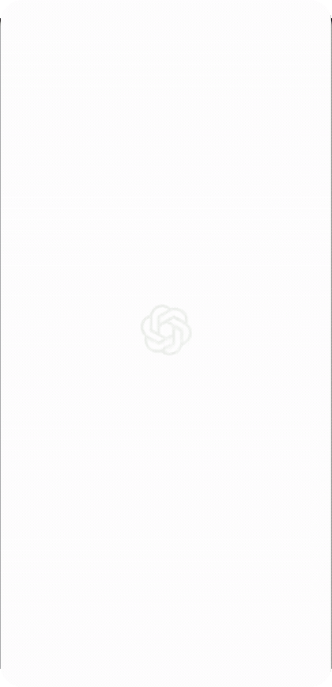

### Enable ChatGPT app to control your phone

  

## Installation

### 1. Download the APK

Go to [Releases](https://github.com/horacioMartinez/chatgpt-unleashed/releases/latest) and download the latest `unleashed.apk`.

### 2. Install on your device

Since the app is not distributed through an app store, you'll need to allow installation from this source. On most Android devices:

1. Open the downloaded APK file.
2. If Android asks you to allow installation from this source, tap **Allow**.
3. Tap **Install**.

> **Note:** If Android blocks installation with a message such as “App blocked to protect your device,” temporarily disable Play Protect app scanning:
>
> Play Store → Profile picture → Play Protect → Settings → Scan apps with Play Protect

Once the app is installed:

- Enable **Accessibility** inside the app.
- Connect to the ChatGPT plugin using your Tunnel ID and Secret key (see the next section).

### 3. ChatGPT plugin installation

Use the same OpenAI account you will use in the ChatGPT mobile app.

Log in to [OpenAI Platform](https://platform.openai.com/), then follow these steps:

1. Open [Tunnel settings](https://platform.openai.com/settings/organization/tunnels), click **Create tunnel**, and complete the fields:

   - Name: `my_unleashed_private_tunnel`
   - Description: `-`
   - Organizations: Select your organization or leave the default.
   - ChatGPT workspaces: Select your workspace or leave the default.

   Create the tunnel and copy its Tunnel ID. You'll use it later.

2. Open [API keys](https://platform.openai.com/api-keys), click **+ Create new secret key**, and complete the fields:

   - Name: `my_unleashed_private_tunnel_key`
   - Project: Select your project or leave the default.
   - Expiration: **Never**
   - Permissions: Select **Restricted**, then enable **Read** and **Use** under Tunnels.

   Create the key and copy the Secret key. You can only view it when it is created.

3. Open unleashed and tap **Connect ChatGPT**. Enter the Tunnel ID and Secret key, then connect. Check that the connection succeeds.

4. Open [ChatGPT Plugins](https://chatgpt.com/plugins) and choose **Add → Add custom MCP server**:

   - Name: `unleashed`
   - Connection: Select **Tunnel** and paste your Tunnel ID.
   - Authentication: Choose **No authentication**.

   Then choose **Connect unleashed**.

5. Verify that unleashed works by asking ChatGPT:

   > Using @unleashed, open my calculator app and compute 1 + 1.
